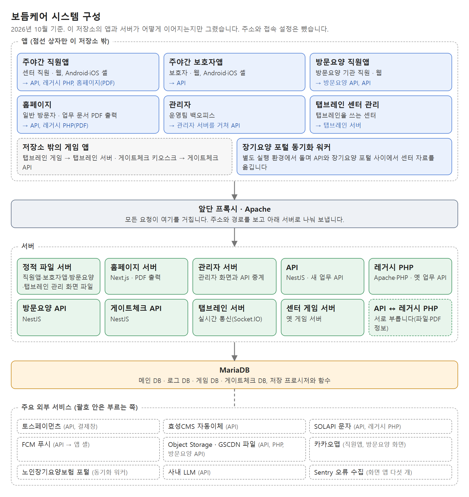

사람이 붙어서 1시간 반씩 하던 배포가 이제 5분이면 끝납니다.

일주일에 한 번 겨우 하던 스테이징(테스트 서버) 배포를 이제는 하루에도 100번씩, 자동으로 합니다.

배포 때마다 겨우 알던 버그를 이제는 코드를 고칠 때마다 테스트 3만 3천 개가 잡아냅니다.

보듬케어는 주야간보호센터(어르신이 낮 동안 머무르며 돌봄을 받는 시설)와 방문요양 기관이 쓰는 업무 프로그램과, 보호자가 쓰는 앱 등을 만드는 서비스입니다. 보듬케어 서비스에 모노레포라는 기술을 도입했고, 이제는 그 시도가 성공적이었다고 판단해서 제가 어떤 시행착오를 겪었는지 공유해 보고자 글을 써 봅니다.

글이 길어서 두 편으로 나눴습니다. 1편에서는 모노레포가 뭔지, 왜 필요했는지, 빌드와 검사가 어떻게 바뀌었는지를 얘기하고, 테스트와 배포 얘기는 [2편](/monorepo-story-2/)에서 하겠습니다.

## 서비스 현황
저장소 이력은 2019년부터 시작했습니다. 7년이 지난 현재 쌓인 커밋은 25,514건(2026년 10월 기준, 머지 커밋 제외)이고, 지금은 홈페이지·주야간 직원앱·주야간 보호자앱·방문요양 직원앱·관리자 백오피스·탭브레인·장기요양 포털 동기화 워커 등 열두 개 앱과 여러 공용 패키지가 한 저장소 안에서 움직입니다. 코드는 약 178만 줄입니다.

### 현재 모노레포에서 관리 중인 앱들
보듬케어라는 서비스 이름 아래에는 이 모노레포에 속하지 않는 앱도 몇 개 더 있습니다. 아래는 이 모노레포 안의 앱들입니다.

| 앱 | 누가·무엇에 쓰나 | 형태 | 주요 기술 | 코드 |
| --- | --- | --- | --- | ---: |
| 주야간 직원앱 | 주야간보호센터 직원의 업무 프로그램 | 웹(PWA) | React, Webpack, SWC | 70.2만 줄 |
| 　└ Android 셸 | 웹 앱을 감싸고 블루투스 생체 측정 기기와 연결 | Android 앱 | Kotlin, Java | 2.2만 줄 |
| 　└ iOS 셸 | 웹 앱을 감싸고 프린터·푸시 알림 연결 | iOS 앱 | Swift | 2천 줄 |
| 주야간 보호자앱 | 주야간보호센터를 이용하는 어르신의 보호자 | 웹(PWA) | React Native 코드를 react-native-web으로 웹 빌드 | 3.9만 줄 |
| 　└ Android 셸 | 스토어 배포 앱. TWA(웹 페이지를 앱처럼 띄우는 Android 기능)에서 푸시를 위한 자체 WebView 셸로 전환 중 | Android 앱 | Kotlin | 1천 줄 |
| 　└ iOS 셸 | 웹 앱을 감싼 스토어 배포 앱 | iOS 앱 | Swift | 1천 줄 |
| 홈페이지 | 일반 방문자. 업무 문서 PDF 출력의 대부분도 맡는다(출력 부분은 별도 앱으로 분리 예정) | 웹 | Next.js | 11만 줄 |
| 관리자 | 운영팀 백오피스 | 웹 | Vite, React, TanStack | 5.9만 줄 |
| API | 여러 앱이 함께 쓰는 백엔드 | 서버 | NestJS, Prisma, Kysely | 53.7만 줄 |
| 방문요양 직원앱 | 방문요양 기관 직원의 업무 프로그램 | 웹 | Vite, React | 10만 줄 |
| 방문요양 API | 방문요양 직원앱의 백엔드 | 서버 | NestJS | 5천 줄 |
| 탭브레인 서버 | 인지 게임 탭브레인의 실시간 통신 | 서버 | Express, Socket.IO | 6.1만 줄 |
| 탭브레인 센터 관리 | 탭브레인을 쓰는 센터의 관리 화면 | 웹 | Vite | 2만 줄 |
| 센터 게임 서버 | 탭브레인 서버와 짝을 이루는 옛 게임 서버 | 서버 | Express, Socket.IO | 6천 줄 |
| 게이트체크 API | 보행 재활 게임의 백엔드 | 서버 | NestJS | 1.1만 줄 |
| 장기요양 포털 동기화 워커 | 노인장기요양보험 포털과 센터 자료를 동기화 | 워커 | Node.js | 1.2만 줄 |
| 레거시 PHP | 오래 운영해 온 화면과 업무 API | 서버 | Apache, PHP | 6.5만 줄 |
| DB 저장 프로시저 · 함수 | 레거시 업무 로직 | DB | MariaDB | 2.6만 줄 |
| **합계** | | | | **약 178만 줄** |

- 2026년 10월 `develop` 기준입니다. 코드는 TypeScript·JavaScript·PHP·Kotlin·Java·Swift·CSS 파일의 줄 수를 천 줄 단위로 반올림했습니다. 테스트와 주석은 포함하고, 외부 패키지·빌드 결과물·타입 선언(`.d.ts`)·압축 파일과 공용 패키지는 뺐습니다.
- 테스트 전용인 e2e 프로젝트 네 개는 앱에서 뺐습니다.
- 레거시 PHP와 DB, 모바일 셸 네 개는 앱 수(열두 개)에 넣지 않았습니다.
- 커밋·참여 인원과 출력 양식 같은 숫자, 외부 서비스 목록은 글 맨 뒤 부록에 모았습니다.

178만 줄이 큰 규모가 아니라는 건 저도 압니다. 개인적으로는 한 사람이 보통 20만~50만 줄 정도의 프로젝트는 유지보수할 수 있다고 생각합니다. 그러니 이 표는 저희 앱의 규모를 자랑하려고 넣은 게 아니고, 한 저장소 안에 어떤 앱들이 어떤 기술로 같이 들어 있는지 보여 드리려고 넣었습니다.

앱과 서버가 서로 어떻게 이어지는지는 그림으로 그려 봤습니다.



## 모노레포와 도입 이유

### 모노레포란

모노레포(monorepo)는 여러 애플리케이션과 라이브러리를 하나의 저장소에서 관리하는 방식입니다. 앱마다, 예컨대 ○○-frontend와 ○○-backend처럼 저장소를 따로 두는 방식은 멀티레포(multi-repo)라고 부릅니다.

2024년 모노레포를 도입하던 시기에는 모노레포를 모르는 분이 더 많았는데, AI 도구를 많이 쓰는 요즘 모노레포가 좀 더 각광받고 있는 것 같습니다. 각 서비스의 의존성 관계를 한 번에 확실하게 파악할 수 있어서라고 생각합니다.

사실 단순히 폴더 여러 개를 한 저장소에 넣는다고 모노레포가 되지는 않습니다. 제대로 된 모노레포라면 다음 질문에 사람이 아니라 도구가 답할 수 있어야 합니다.

- 이 공용 함수가 바뀌면 어떤 앱을 다시 빌드해야 하는가?
- 프론트엔드가 사용하는 API 타입은 어디서 만들어지는가?
- 앱보다 먼저 빌드해야 할 패키지는 무엇인가?
- 이번 변경과 관계없는 테스트까지 전부 돌릴 필요가 있는가?
- 같은 입력으로 이미 성공한 빌드 결과를 다시 쓸 수 있는가?

저장소가 앱별로 나뉘어 있다면 API 응답 필드 하나를 바꿀 때 보통 이런 일이 생깁니다. API 저장소에서 응답을 바꾸는 경우, 호환성을 지키려면 v1(기존 API)을 남긴 채 v2(새 버전)를 올리고 일정 기간 뒤에 v1을 내려야 합니다. 그동안 두 버전을 함께 관리해야 합니다. 클라이언트 개발자 입장에서 v1, v2가 헷갈리고, 그것을 섞은 클라이언트를 개발하는 경우도 있습니다.

보듬케어 API는 NestJS 서버 코드에서 SDK(`@bodumcare/api-sdk`)를 TypeScript 기반으로 자동으로 만들고, 그 안에 요청과 응답의 타입이 함께 들어 있습니다. 클라이언트는 SDK를 불러와(import) 사용하고 서버의 입출력 변경으로 인한 타입 오류를 즉각 알 수 있습니다.

```ts
// SDK 없이(예시): 주소와 응답 모양을 사람이 기억해서 맞춘다
const res = await fetch(`/centers/${centerId}/senior-citizens/${id}`)
const senior = await res.json() // 무엇이 들어 있는지 코드만 봐서는 알 수 없다
const b = senior.b as B // 또는 프론트엔드 코드에서 자신만의 타입을 주장하기도 한다.

// SDK로: 서버 코드에서 만든 함수와 타입을 그대로 쓴다
import api from '@bodumcare/api-sdk'
const { item } = await api.functional.centers.senior_citizens.with_basic_ability_assessments
  .findSeniorCitizenWithBasicAbilityAssessments(connection, centerId, id)
// 파라미터는 물론 반환 값까지 모두 정상적인 타입으로 추론된다. 응답 타입은 API 코드가 정하고, 프론트엔드는 그대로 받아 쓴다.
```

서버에서 응답 필드 이름을 바꾸면 SDK의 타입도 같이 바뀌고, 옛 이름을 쓰던 프론트 코드는 빌드나 타입 검사에서 바로 오류가 납니다. 멀티레포라면 SDK를 패키지로 배포하고 저장소마다 버전을 올린 뒤에야 그 오류를 볼 수 있습니다. 모노레포에서는 서버를 고친 그 MR(머지 요청) 안에서 보입니다. API, 생성된 SDK, 프론트 변경을 한 브랜치와 한 MR에 담을 수 있습니다.

### 여러 기술이 섞인 서비스

보듬케어는 한 가지 기술로 쭉 만들어 온 서비스가 아닙니다. 처음에는 Express 서버로 개발을 시작했고, 이후에는 PHP와 DB 저장 프로시저 중심으로 옮겨서 운영했습니다. 지금은 다시 NestJS 기반 API로 조금씩 옮기고 있습니다. 그래서 위 표에는 React·Next.js·React Native·NestJS 옆에 Apache·PHP·MariaDB와 저장 프로시저가 같이 있고, Android·iOS 셸도 이 저장소에서 빌드합니다.

### 도입 전 상황

사실 모노레포를 도입하기 전에는 저장소부터 나뉘어 있었습니다. 프론트엔드와 백엔드가 서로 다른 저장소에 있었고, 프론트엔드도 원래는 주야간 직원앱과 보호자앱이 따로였습니다. 백엔드 코드가 지금 저장소로 들어온 건 2024년 10월입니다. 앱마다 빌드하는 방법도 제각각이었고, 공용 코드는 2022년 3월부터 사내 패키지 서버(Verdaccio)에 올려서 앱마다 버전을 맞췄습니다.

그런데 앱끼리 나눠 쓰는 코드는 생각보다 많았습니다. 지금 저장소를 기준으로 보면 이렇습니다.

| 공유하는 것 | 함께 쓰는 앱 |
| --- | --- |
| 공용 함수 패키지 | 앱 여덟 개: 주야간 직원앱·보호자앱, 방문요양 직원앱·API, 홈페이지, 관리자, API, 게이트체크 API |
| API에서 생성한 SDK(TypeScript 타입 포함) | 프론트 다섯 개: 주야간 직원앱·보호자앱, 방문요양 직원앱, 홈페이지, 관리자 |
| Prisma 스키마와 클라이언트 | 서버 셋(API, 방문요양 API, 게이트체크 API)과, 그 타입을 쓰는 프론트 |
| 위지윅 에디터, React 공용 컴포넌트 | 주야간 직원앱, 관리자, 홈페이지, 방문요양 직원앱 |

API 응답 하나를 바꾸면 프론트 다섯 개의 타입이 같이 바뀌고, 공용 함수 하나를 고치면 앱 여덟 개가 영향을 받습니다. 이 관계를 문서나 도구 없이 사람이 기억하고 있었습니다.

> 이 공용 패키지를 고치면 주야간 직원앱과 홈페이지를 같이 봐야 한다.  
> API 스키마를 바꾸면 SDK부터 다시 만들어야 한다.  
> 이 앱은 아직 옛 공용 패키지를 사용한다.

앱이 몇 개 안 될 때는 경험 많은 개발자가 기억하면 됩니다. 하지만 앱이 열 개를 넘고, 코드를 고치는 사람이 몇 명 안 되는 팀에서는 그렇게 버티기 어렵습니다. 아는 사람이 자리를 비우면 어디까지 확인해야 하는지 아무도 모르게 됩니다.

### 모노레포로 바란 것

그래서 모노레포로 이렇게 하고 싶었습니다.

1. API, SDK, 그걸 쓰는 앱의 수정을 한 MR에 넣고 같이 리뷰하고 배포합니다. 공용 패키지를 Verdaccio에 따로 올리고 앱마다 버전을 올리는 절차도 줄입니다.
2. 어떤 변경이 어떤 앱에 영향을 주는지 도구가 계산해서, 필요한 앱만 빌드하고 검사합니다.
3. Node·패키지 매니저·핵심 라이브러리 버전과 lint(코드 규칙 검사)·타입 검사·테스트를 앱마다 정하지 않고 저장소 단위로 맞춥니다.

## 성공했다고 생각한 계기

도입이 성공했다고 생각하게 된 건, API나 DB만 고친 MR에서 그걸 쓰는 앱의 문제가 바로 드러나기 시작하면서였습니다.

저장소가 따로였다면 API를 고친 쪽의 검사는 다 통과했을 겁니다. 그 API를 쓰는 앱이 깨졌다는 건 앱 쪽에서 SDK 버전을 올리거나, 배포한 뒤에야 알 수 있었을 겁니다. 지금은 API나 DB를 고친 MR에서도 그 코드를 쓰는 앱의 빌드와 타입 검사가 같이 돌고, DB 스키마나 직원앱이 쓰는 API를 고치면 e2e 테스트(실제 DB와 서버를 띄워 놓고 앱을 돌려 보는 테스트)도 돌아갑니다. 결과는 MR을 올리고 10분 안팎이면 나오고, 통과하지 못하면 머지할 수 없습니다.

2026년 9월 말부터 10월까지 4주 동안 있었던 일 가운데 세 가지만 들면 이렇습니다. 셋 다 API 쪽 검사는 통과했습니다.

| MR에서 바꾼 것 | 실패한 검사 | 알기까지 |
| --- | --- | ---: |
| API에서 안 쓰는 공개 코드(export) 55개 정리 | 관리자·홈페이지·보호자앱·방문요양 직원앱의 빌드와 타입 검사 | 7분 |
| DB의 옛 컬럼 하나를 Prisma 스키마에서 정리 | 주야간 직원앱 e2e 테스트 52개 중 9개 | 12분 |
| API가 받는 값을 아무 문자열에서 정해진 이름 8개로 좁힘 | 관리자 화면 타입 검사 | 5분 |

첫 번째는 API에서 안 쓰는 줄 알고 지운 타입을, API에서 자동으로 만든 SDK가 아직 가리키고 있던 경우입니다. 그 SDK를 쓰는 프론트 앱 네 곳의 빌드와 타입 검사가 한꺼번에 실패했습니다.

두 번째는 DB 변경이었습니다. 청구 테이블의 옛 컬럼을 새 컬럼으로 옮기는 중이었고, 이 MR에서는 API가 옛 컬럼을 더 이상 쓰지 않게 하면서 Prisma 스키마(DB 테이블 구조를 코드로 적은 파일)에서도 그 컬럼을 정리했습니다. API 검사와 프론트 타입 검사는 모두 통과했습니다. 그런데 주야간 직원앱 e2e 테스트는 DB를 이 스키마로 새로 만들어 쓰는데, 저장 프로시저와 테스트 데이터는 아직 그 컬럼을 읽고 있었습니다. 청구 상세 조회와 선납금(미리 받은 이용료) 상계 테스트 9개가 컬럼이 없다는 DB 오류로 실패했습니다. 그래서 컬럼을 지우는 일은 다음 단계로 미루고, 스키마에 컬럼을 남겨 둔 채 머지했습니다.

세 번째는 API가 받는 값의 타입을 좁힌 경우입니다. API 쪽 코드와 테스트는 문제가 없었지만, 관리자 화면에서 그 API에 일반 문자열을 넘기던 코드가 타입 검사에서 걸렸습니다.

지금은 어느 앱의 어느 파일 몇 번째 줄에서 무슨 타입이 안 맞는지, 어떤 테스트가 무슨 오류로 실패했는지가 MR에 나오고, API를 고친 사람이 그걸 바로 봅니다. 예전에는 배포하는 날에야 빌드가 깨졌다는 것 정도만 알았습니다.

## 도입하면서 겪은 일들

여기까지 오는 데 몇 년이 걸렸습니다. 툴을 하나씩 바꿔 왔는데, 제가 해 보니 코드를 한 저장소에 모으는 것보다 빌드와 검사 규칙을 하나로 맞추는 데 손이 훨씬 많이 갔습니다.

아래에서는 Nx, Prisma, pnpm, Node 버전 고정, TypeScript 전환, CI(코드를 올릴 때마다 서버가 대신 돌려 주는 빌드와 검사)로 거는 머지 전 검사 순서로 얘기하겠습니다.

---

## 1. Nx 도입과 빌드 캐시

2024년 8월에 `init nx`라는 커밋으로 Nx가 들어왔습니다. Nx는 모노레포용 빌드 툴입니다. 앱과 패키지가 어떻게 연결돼 있는지 보고 바뀐 것만 골라 빌드하고(affected), 한 번 만든 결과는 저장해 뒀다가 다시 씁니다(캐시).

주야간 직원앱 빌드를 예로 들어 보겠습니다.

### 빌드 시간

주야간 직원앱 빌드는 직원앱 코드만 묶는다고 끝나지 않습니다. 먼저 공용 함수 패키지를 빌드하고, DB 스키마에서 타입을 만들고, API 서버 코드에서 SDK를 생성한 다음에야 직원앱을 빌드할 수 있습니다. 지금 제 PC에서 재면 다음과 같습니다.

| 상황 | 걸린 시간 |
| --- | ---: |
| 캐시 없이 전부 빌드 | 6분 42초 (그중 API SDK 생성만 5분 21초) |
| 직원앱 코드만 바뀌었을 때 | 1분 18초 |
| 아무것도 바뀌지 않았을 때 | 17초 |

캐시가 없으면 언제나 첫 줄입니다. 직원앱 화면 문구 하나를 고쳐도 SDK부터 다시 만들어야 하고, 앱이 여러 개면 그 시간을 앱 수만큼 곱해야 합니다. Nx 캐시를 쓰면 둘째, 셋째 줄이 됩니다.

### 캐시 설정을 잘못 잡았던 일

2026년 6월에 스테이징 서버에서 주야간 직원앱 주소로 들어가면 404가 났습니다. 배포는 성공으로 끝났는데 직원앱 파일이 하나도 없었습니다.

Nx는 입력이 지난번과 같으니 이미 빌드한 것이라고 판단해서 빌드를 건너뛰었습니다. 그러면 지난번 결과 파일을 되살려 놔야 하는데, 결과 파일이 어디에 생기는지를 Nx에게 알려 주지 않았던 겁니다. 빈 폴더가 그대로 이미지(앱과 실행 환경을 묶은 배포 파일)에 담겨 배포됐습니다.

반대 방향의 실수도 있었습니다. 빌드 결과에 들어가는 설정 파일을 고쳤는데, 그 파일이 캐시의 "입력" 목록에 없어서 Nx는 아무것도 바뀌지 않았다고 판단했습니다. 고친 내용 대신 예전 결과가 그대로 나왔습니다.

결국 앱마다 캐시의 입력과 결과 목록을 하나씩 다시 점검해서 고쳤습니다.

### 캐시 때문에 느려진 CI

CI는 잡(CI에서 도는 작업 하나)이 시작할 때마다 작업 폴더를 비우기 때문에, 그 안의 캐시도 같이 지워집니다. CI에서도 캐시를 쓰려고, 잡이 끝날 때마다 캐시 폴더를 압축해서 저장해 두고 다음 잡이 시작할 때 풀어서 되살리게 했습니다. 시간이 지나자 캐시 폴더의 파일이 70만 개로 불어났습니다. 잡 하나의 시간을 단계별로 나누면 이렇습니다.

- 잡 전체 44.8분
- 캐시 풀기 8.5분, 캐시 다시 압축하기 17분
- 실제로 빌드한 시간 18.5분

캐시를 압축하고 푸는 데만 26분을 썼는데, 정작 풀어 놓은 캐시는 쓰이지 않고 있었습니다. Nx가 이미 빌드했는지를 판정할 때 쓰는 작은 DB 파일이 있는데, 그 파일은 빼고 결과물만 옮겼기 때문입니다. 판정 기록이 없으니 매번 처음부터 빌드했고, 캐시를 안 쓸 때보다 더 느렸습니다.

그래서 CI에서 캐시를 압축해서 다음 잡에 넘기는 방식을 그만뒀습니다. 대신 캐시와 판정 DB를 작업 폴더 밖, 러너(CI 작업을 실제로 돌리는 서버)의 디스크에 그대로 두고 다음 잡이 그 자리에서 바로 쓰게 하니, 압축하고 푸는 시간이 없어졌습니다.

### 공유 캐시와 보안

2026년 9월에는 사내 캐시 서버를 둬서 다른 PC나 러너가 만든 결과도 받아 쓰게 했습니다. 캐시 서버가 고장 나도 각자의 캐시만 쓰고 빌드는 계속됩니다.

다만 라이브(실서비스)와 스테이징에 나가는 빌드는 이 공유 캐시를 읽지도 쓰지도 않습니다. 배포되는 파일은 리뷰를 거친 소스로 서버가 직접 만든 것이어야 하기 때문입니다. 배포 스크립트가 공유 캐시를 강제로 끄고, 설정을 잘못 건드려도 이 동작이 바뀌지 않는지 테스트로 확인합니다.

---

## 2. Prisma 도입

Prisma의 초기 도입 커밋은 2024년입니다. 기존 코드를 유지하면서 Prisma와 함께하는 새 코드에서는 다음을 얻고자 했습니다.

- DB 스키마에서 자동으로 만들어지는, 타입이 붙은 DB 클라이언트
- 모델을 바꾸면 API와 그 API를 쓰는 앱의 타입까지 같이 바뀌는 구조
- 언제 다시 돌려도 같은 결과가 나오는 마이그레이션(DB 구조를 바꾸는 스크립트) 이력
- 로컬·스테이징·라이브에서 같은 순서로 실행되는 DB 작업
- 복잡한 조회는 Kysely로, 기존 업무 로직은 저장 프로시저로 계속 쓸 수 있는 여지

이 가운데 마이그레이션을 배포에서 어떻게 돌리는지는 2편에서 얘기하고, 여기서는 타입 쪽만 적겠습니다.

모노레포에서는 Prisma 스키마 파일의 영향이 API 밖까지 갑니다. 스키마가 바뀌면 그걸로 만든 타입과 API SDK 타입이 바뀌고, 그 SDK를 쓰는 주야간 직원앱·관리자·홈페이지까지 영향을 받습니다. 그래서 스키마 파일을 고치면 프론트엔드 타입 검사도 같이 돌게 해 두었습니다.

### 32MB짜리 타입 파일

Prisma는 DB 스키마를 읽어서 타입이 담긴 코드를 자동으로 만들어 줍니다. 그런데 테이블이 많다 보니(메인 DB 기준 수백 개) 이렇게 만든 타입 파일 하나가 약 32MB나 됩니다. 이 파일을 만드는 작업과 읽는 작업이 동시에 돌면, 한쪽이 파일을 다 쓰기도 전에 다른 쪽이 읽어 버립니다. 그러면 코드에는 아무 문제가 없는데도 "문법 오류" 같은 엉뚱한 실패가 납니다. 한 번 실행하는 안에서는 이 파일을 만드는 일이 한 번에 하나씩, 정해진 순서대로만 돌게 했습니다. 다만 작업을 따로 두 개 띄우면 아직 겹칠 수 있어서, 동시에 돌리지 말라고 저장소 안내 문서(`AGENTS.md`, AI 코딩 도구와 사람이 함께 읽는 문서)에 적어 두었습니다.

---

## 3. npm에서 pnpm으로

pnpm은 npm처럼 외부 패키지를 설치해 주는 도구입니다. 보듬케어 저장소는 패키지 4,400여 개를 설치합니다. CI에서 한 번 설치할 때 걸린 시간(중간값)은 이렇습니다.

| 시기 | 도구 | 설치 시간 |
| --- | --- | ---: |
| 2026년 7월 | npm | 46초 |
| 2026년 8월 | pnpm | 15.6초 |
| 2026년 10월 | pnpm, 저장소를 작업 폴더 밖으로 옮긴 뒤 | 3.1초 |

npm과 pnpm은 패키지를 저장하는 방식이 다릅니다. npm은 프로젝트마다 패키지 파일을 통째로 복사해 넣습니다. pnpm은 컴퓨터에 패키지를 한 벌만 받아 두고, 프로젝트에는 그 파일을 가리키는 연결만 만듭니다. 그래서 작업 폴더를 여러 개 만들어도 같은 패키지를 다시 받지 않습니다. 마지막 줄의 3.1초는 pnpm이 패키지를 받아 두는 저장소(store)를 CI 작업 폴더 밖에 둬서, 잡마다 압축을 풀지 않게 한 뒤의 숫자입니다.

2026년 7월에 npm에서 pnpm으로 옮기면서, 맞물려 있던 Node 버전 관리도 Volta에서 fnm으로 같이 바꿨습니다(Node 얘기는 다음 장에서 하겠습니다). 속도 말고도 좋아진 점이 있었습니다.

- npm에서는 `package.json`에 적지 않은 패키지도 우연히 설치돼 있으면 가져다 쓸 수 있었습니다. 옮기면서 선언하지 않고 쓰던 공용 패키지 다섯 개가 드러났고, 모두 정식으로 선언했습니다.
- 저장소 안 공용 패키지는 `workspace:*`로 연결해서 항상 저장소의 최신 코드를 쓴다는 게 분명해졌고, 주요 라이브러리 버전은 한 파일(catalog)에서 맞춥니다.
- 아래 보안 정책 대부분을 pnpm 설정 한곳에서 관리합니다. 실수로 npm을 쓰면 설치가 아예 안 되게도 막았습니다.

다만 pnpm 본래의 엄격한 설치 구조는 쓰지 못했습니다. React Native 같은 기존 툴 일부가 npm식 평평한 폴더 구조를 전제로 만들어져 있어서, 설치 구조만은 npm과 비슷하게 남겼습니다(`nodeLinker: hoisted`).

설치에 걸어 둔 보안 정책은 이렇습니다.

- 공개된 지 7일이 안 된 패키지는 기본적으로 설치하지 않습니다(보안).
- 설치하면서 스크립트를 실행해도 되는 패키지는 허용 목록으로 관리합니다.
- 취약한 하위 패키지는 강제로 올리되, 이유와 지울 시점을 같이 적습니다.
- 직접 패치를 댄 패키지가 열두 개 있습니다.

효과가 가장 컸던 패치는 PDF를 만드는 `@react-pdf/pdfkit`에 댄 것입니다. PDF를 한꺼번에 많이 출력하면 브라우저 탭이 메모리를 너무 많이 써서 죽었습니다. 라이브러리 쪽 수정을 기다릴 수 없어서 직접 패치를 댔고, 나중에 공식 수정으로 바꿀 수 있도록 언제 이 패치를 지워도 되는지까지 주석으로 남겼습니다.

---

## 4. Node와 라이브러리 버전 고정

모노레포에서는 Node 버전이나 핵심 라이브러리 버전이 개발자마다 달라서는 안 됩니다. 같은 패키지 목록을 설치하고 같은 빌드 캐시를 나눠 쓰려면, 누구 PC에서든 CI에서든 같은 버전이어야 합니다. 흔히 듣는 "제 컴퓨터에서는 되는데요"가 여기서 나옵니다.

### Node 버전 고정

2023년 TypeScript를 처음 넣었을 무렵, `package.json`에는 "Node 12든 14든 16 이상이든 다 된다"는 식으로 아주 넓은 범위가 적혀 있었습니다. 작은 프로젝트라면 편하지만, 모노레포에서는 한 사람 PC에서는 되는 코드가 다른 사람 PC에서는 안 되거나, 같은 코드가 로컬과 CI에서 다르게 빌드되는 원인이 됩니다.

2024년부터는 Volta라는 툴로 Node 버전을 고정하기 시작했습니다. 그해 10월 Node 22가 LTS(장기 지원 버전)가 되자 바로 올려 봤는데, 호환성 문제로 같은 날 다시 20으로 되돌렸습니다. 이후 20.18.3, 24.15.0을 거쳤고, 그 뒤로는 보안 릴리스가 나올 때마다 올려서 지금은 24.22.1을 씁니다.

여기서 고정이라는 건 "24 이상"처럼 범위로 적지 않고 정확히 `24.22.1` 하나만 쓰게 한다는 뜻입니다. 이 값은 `.node-version`이라는 파일 하나에 적어 두고, 로컬 PC·CI·Docker 이미지가 모두 그 파일을 보고 맞춥니다. 다른 버전으로 설치하려고 하면 설치가 실패하고, Docker 이미지의 Node가 이 파일과 다르면 검사에서 걸리게 해 두었습니다.

### Volta에서 fnm + Corepack으로

Volta는 Node와 npm을 같이 고정하기 편한 툴이었는데, 패키지 매니저를 pnpm으로 옮기면서 맞지 않는 부분이 생겼습니다. 그래서 역할을 둘로 나눴습니다.

- fnm은 `.node-version`을 보고 Node 버전만 고릅니다.
- Corepack은 `package.json`을 보고 정확한 pnpm 버전을 준비합니다.

로컬·CI·Docker 모두 이 두 파일을 보고 버전을 맞춥니다. CI에서는 fnm이 자동으로 켜지지 않아서 `Could not find executable pnpm` 오류가 나는 등 몇 번 삐끗했는데, 이런 디테일은 생략하겠습니다.

### React 17에서 19까지

React를 비롯한 핵심 라이브러리는 이렇게 올려 왔습니다.

| 시기 | 변화 |
| --- | --- |
| 2021-10 | Webpack 4→5, Babel 7 전환 및 `@babel/polyfill` 제거 |
| 2023-02 | React 17.0.2 기반 코드에 TypeScript 4.9와 ts-loader 도입 |
| 2023-05~07 | React Native 0.64.2→0.71.8→0.72.1 순차 업그레이드 |
| 2024-07 | 일부 프론트 빌드를 Vite로 전환 |
| 2024-08 | React 18.2.0→18.3.1 업그레이드 |
| 2024-08 | Nx 19.5.7, Next.js 14.2.3 시기의 모노레포 초기화 |
| 2024-12 | React 19 대응 준비, React Native 0.76.5와 관련 패키지 정리 |
| 2025-02 | React 19 전환, React Native 0.78로 동반 업그레이드 |
| 현재 | React 19, Next.js 16, React Native 0.83, Nx 23 |

React를 올릴 때는 React Native도 같은 React 버전을 지원해야 했고, 날짜 선택기나 모달 같은 주변 패키지도 같이 맞춰야 했습니다. 2024년 말에는 React Native가 React 19를 정식으로 지원하기 전이라 억지로 설치해야 했던 시기도 있었습니다.

모노레포라서 핵심 버전을 한곳에서 올리고 그 버전을 쓰는 앱을 한 MR에서 다 확인할 수 있는데요. 대신 앱 하나라도 새 React를 못 받으면 전체 업그레이드가 막힙니다.

### 고정하는 기준

그렇다고 모든 패키지 버전을 하나로 박아 두지는 않고, 바뀌었을 때 얼마나 위험한지를 보고 정합니다.

- Node, pnpm, React, Webpack처럼 결과 전체를 바꾸는 기반 툴은 정확한 버전 하나로 고정합니다.
- PDF 렌더러처럼 버전에 따라 출력물 모양이 달라지는 라이브러리도 고정합니다.
- 직접 패치를 댄 패키지도 고정합니다. 버전이 바뀌면 패치가 맞지 않기 때문입니다.
- 나머지 일반 라이브러리는 범위를 허용하되, 저장소 전체가 catalog의 버전을 따릅니다.

버전을 고정해도 업그레이드는 계속합니다. 다만 올리는 시점은 저희가 정합니다.

---

## 5. TypeScript 전환

다음은 TypeScript 전환입니다. 모노레포 도입보다 먼저, 2023년에 본격적으로 시작했습니다. 한 번에 전환할 수는 없었습니다.

### 점진적 전환

JavaScript 파일 확장자만 `.ts`로 바꿔서는 타입이 안전해지지 않습니다. 오래된 화면 코드에는 화면 상태, API 응답, Redux 데이터, jQuery가 섞여 있었고, 값이 어떻게 생겼는지 어디에도 적혀 있지 않은 채 그냥 그렇게 생겼으려니 하고 쓰는 곳이 많았습니다. 이걸 한 번에 타입으로 옮기려고 하면 기능 개발이 멈추거나, 결국 전부 `any`(아무 값이나 받는 타입)로 덮어서 타입 검사가 거의 의미 없는 코드가 됩니다.

그래서 화면이나 기능에 손댈 때 관련 코드를 같이 옮겼습니다. 느리긴 해도 실제 동작을 아는 상태에서 타입을 붙일 수 있었고, 그동안에도 제품은 계속 배포할 수 있었습니다. 날짜 객체나 폼 데이터처럼 짐작으로 쓰던 값의 모양도 이때 하나씩 드러났습니다.

### 타입 검사를 커밋 훅에 맡겼을 때

TypeScript는 API 필드 이름 오타나 `null`일 수 있는 값, 잘못된 함수 인자를 실행하기 전에 잡아 줬습니다. 공용 코드를 고치면 그걸 쓰는 앱의 오류가 바로 드러났고요.

그런데 TypeScript를 설치해 놓아도 타입 검사는 따로 돌려야 합니다. 요즘 빌드 툴이나 테스트 툴은 대부분 속도 때문에 TypeScript를 JavaScript로 바꾸기만 하고 타입은 보지 않습니다. 그래서 타입 오류가 있어도 빌드는 성공하고 테스트도 통과합니다.

처음에는 "커밋 전에 타입 검사를 돌린다"는 규칙을 정하고, 커밋할 때 검사가 자동으로 돌도록 커밋 훅도 걸었습니다. 하지만 이 규칙은 생각보다 쉽게 건너뛸 수 있었습니다.

- 커밋 훅은 `--no-verify` 한 줄이면 꺼집니다. 검사가 느리거나 상관없어 보이는 오류에 걸리면 끄고 커밋하는 사람이 생깁니다.
- 라이브 장애를 급히 막는 핫픽스처럼 "이번만은" 건너뛰고 싶을 때도 있고, 그냥 잊을 때도 있습니다.

---

## 6. 머지 전 검사

그래서 규칙을 어길 수 없게 만드는 장치가 필요했습니다. 개발자 PC에서 커밋 훅을 껐든 안 껐든, 서버 쪽 검사를 통과하지 못한 코드는 머지하지 못하게 하는 겁니다.

그 중심이 CI/CD입니다. 앞에서 말한 CI는 Continuous Integration(지속적 통합)의 줄임말이고, 검사를 통과한 코드를 서버에 내보내는 일까지 자동으로 이어 주는 것이 CD(Continuous Delivery/Deployment, 지속적 배포)입니다. 예전에는 검사가 배포할 때 처음 돌았습니다. 코드를 합칠 때는 아무도 빌드해 보지 않으니, 라이브 배포 직전에야 빌드가 실패해서 급히 원인을 찾는 일이 잦았고, 빌드는 통과했는데 동작이 깨진 코드가 그대로 라이브에 나가는 일도 많았습니다.

GitLab CI로 옮기고 나서야 검사가 머지 전에 돌게 됐습니다. MR을 올리면 그 MR만 가지고 빌드·타입 검사·테스트가 돌고, 통과하지 못하면 머지 버튼이 열리지 않습니다. 커밋 훅을 끄고 올린 코드도 여기서 걸립니다. 흔히 게이트라고 부르는 건데, 이 글에서는 머지 전 검사라고 쓰겠습니다. 배포가 사람 손에서 Jenkins를 거쳐 GitLab CI로 넘어온 과정은 2편에서 얘기하겠습니다.

예전에는 타입 오류가 머지된 뒤 스테이징 배포 빌드에서야 터져서 다른 사람의 배포까지 같이 멈췄습니다. 지금은 대부분 오류를 낸 MR에서 걸립니다. 머지 뒤에야 터진 일도 있었는데, 그 얘기는 2편에서 하겠습니다.

### GitLab CI에서 달라진 것

코드 리뷰는 GitLab MR에서 하는데 빌드 결과가 Jenkins에 있으면, 코드를 보는 곳과 검사 결과를 보는 곳이 따로 놉니다. 지금은 MR 화면 하나에서 바뀐 코드와 리뷰 대화, 테스트·타입 검사·lint 결과, 보안 검사 결과, 머지 가능 여부, 배포 상태를 같이 봅니다.

저희는 MR을 AI 리뷰봇이 먼저 리뷰하고, 지적이 없으면 봇이 직접 머지합니다. 이때도 리뷰 승인과 상관없이 이 검사와 보안 검사를 모두 통과해야 합니다.

테스트가 실패하면 어떤 테스트가 왜 실패했는지 MR 화면에서 보이게 했고, 검사 하나가 실패해도 나머지 검사는 끝까지 돌려서 한 번에 여러 문제를 볼 수 있게 했습니다.

GitLab CI/CD를 운용하면서 갖은 옵션의 상세, 러너 설정, Nx의 affected 등 얘기할 부분은 많지만 너무 디테일해서 이 글에서는 생략하겠습니다.

### 이미 쌓인 오류

이미 오류가 수천 건 쌓인 앱에 "오류가 하나라도 있으면 머지 금지"를 걸면 그날부터 아무도 머지를 못 합니다. 저희 앱 하나가 그런 경우였는데요. 2026년 10월에 쌓여 있던 타입 오류와 lint 경고를 모두 0으로 만든 다음에야 새 오류가 하나라도 있으면 머지할 수 없게 막았습니다.

그렇다고 모든 검사를 0이 될 때까지 기다렸다가 걸 수는 없습니다. 기다리는 동안에도 오류는 새로 들어오기 때문입니다. 그래서 래칫(ratchet, 한쪽으로만 도는 톱니바퀴) 방식도 같이 썼습니다. 지금 있는 오류는 "기준선" 목록에 적어 두고 일단 허용하되, 기준선에 없는 새 오류는 머지를 막습니다. 기준선은 줄이기만 하고 늘리지 않습니다. 오류를 고치면 그 항목을 기준선에서 지우고, 지운 오류가 다시 생기면 새 오류로 잡힙니다.

쓰지 않는 코드와 패키지를 찾아 주는 검사(Knip)가 그 예입니다. 2026년 10월에 처음 돌렸을 때 지적이 1,774건이었습니다. 이 목록을 기준선으로 두고 새 지적만 막은 다음, 앱별로 나눠서 고치고 지적이 맞지 않는 것은 사유를 적어 예외로 돌려서 기준선을 0까지 줄였습니다. 지금은 MR에 새 지적이 하나라도 있으면 머지할 수 없습니다. 보안 검사(Semgrep)도 같은 방식으로, 바뀐 파일에서 새로 나온 문제만 머지를 막습니다.

---

## 모노레포를 도입하지 않은 팀에 전하고 싶은 것

1. 저장소를 합치기 전에 어떤 앱이 어떤 공용 코드와 API를 쓰는지, 무엇을 먼저 빌드해야 하는지부터 정리해 보세요.
2. 캐시는 무엇을 보고 같은 입력이라고 판단하는지, 결과물을 어디서 되살리는지부터 확인해 보세요. 저희는 캐시가 틀려서 빈 폴더가 그대로 배포된 적이 있습니다.
3. CI 시간은 명령이 도는 시간만이 아닙니다. 소스 받기, 패키지 설치, 캐시 압축과 풀기, 러너 대기까지 다 재 봐야 합니다. 저희는 재 보기 전까지 캐시가 오히려 CI를 느리게 만든다는 걸 몰랐습니다.
4. 패치, 보안 경고 무시, lint 규칙 끄기 같은 예외에는 언제 지울 수 있는지도 같이 적어 두세요.
5. 한꺼번에 바꾸지 마세요. 저희는 JavaScript→TypeScript, PHP→NestJS, 저장 프로시저→Prisma/Kysely, npm→pnpm, Jenkins→GitLab CI를 몇 년에 걸쳐 하나씩 옮겼습니다. 검사도 기존 오류가 수천 건인 상태에서 바로 머지 조건으로 걸지 않고, 새 오류만 막는 것부터 시작했습니다.
6. 반복해서 겪은 실패는 적어 두세요. Prisma 타입 파일을 왜 동시에 만들면 안 되는지, CI 캐시를 왜 작업 폴더 밖에 두는지는 설정 파일만 봐서는 알 수 없습니다. 저희는 이런 내용을 `AGENTS.md`, CI 주석, 검사 코드에 남깁니다.

---

## 맺으며

처음 `init nx` 커밋을 넣은 지 2년이 조금 넘었습니다. 그동안 툴을 여러 번 바꿨고, 캐시나 검사 범위를 잘못 잡아서 틀린 결과를 낸 적도 많았습니다. 그래도 지금은 API를 고친 사람이 그 API를 쓰는 앱의 문제를 MR에서 바로 보고, 고친 코드는 몇 분 뒤 스테이징에 올라갑니다. 저는 이 정도면 도입이 성공했다고 생각합니다.

모노레포 도입을 고민하는 분들께 참고가 되면 좋겠습니다. 2편에서는 머지 전에 도는 테스트와, 이렇게 모은 코드를 서버에 내보내는 배포 얘기를 하겠습니다.

---

## 부록

본문에 다 담지 못한 숫자와 목록을 모았습니다.

### 지금 쓰는 도구

지금 저장소는 이런 도구로 돌아갑니다.

| 영역 | 현재 선택 | 역할 |
| --- | --- | --- |
| 모노레포 빌드 | Nx 23 | 앱 사이 관계 파악, 바뀐 것만 빌드, 로컬·공유 캐시 |
| 패키지 매니저 | pnpm 12 | 공용 패키지 연결, 버전 통일, 설치 정책 |
| 런타임 | Node 24.22.1 + fnm | `.node-version` 하나로 개발·CI·Docker 버전 통일 |
| 언어 | TypeScript 중심, JavaScript·PHP 공존 | 점진 전환과 기존 제품 유지 |
| DB 접근 | Prisma·Kysely·저장 프로시저 공존 | 타입 안전성과 레거시 업무 로직의 공존 |
| 빌드·배포 | Docker + GitLab CI + Harbor | 머지 전 검사, 이미지 배포, blue-green 스테이징·라이브 배포 |
| 코드 품질 | oxlint, Prettier, Husky, lint-staged | 빠른 lint와 커밋 전 자동 포맷 |
| 테스트·보안 | Jest, Vitest, Playwright, Semgrep | 앱별 테스트와 머지를 막는 보안 검사 |
| 의존성 정책 | catalog, minimumReleaseAge, audit, Knip | 버전 통일, 신규 버전 7일 대기, 미사용 코드 억제 |
| 내부 패키지 | workspace 패키지 + Verdaccio | 저장소 안 직접 연결과 자체 배포 패키지 병행 |

### 커밋과 참여 인원

2026년 10월 `develop` 기준입니다. 같은 사람이 여러 이름·이메일로 남긴 커밋은 한 사람으로 합쳤고, 머지 커밋 6,634건(그중 5,615건은 리뷰봇의 자동 머지)은 세지 않았습니다.

| 누가 | 커밋 | 기간 |
| --- | ---: | --- |
| 본인(이상준, sacru2red) | 15,899 | 2020-11 ~ 2026-10 |
| 그 외 (다른 참여자, 봇·자동화·테스트 계정) | 9,615 | 2019-09 ~ 2026-10 |
| **전체** | **25,514** | |

### 출력 양식

사용자가 PDF·엑셀·한글 파일로 내려받는 문서 양식은 수백 종이고, PDF는 대부분 홈페이지 앱이 만듭니다. 홈페이지와 문서 출력은 성격이 다른 일이라, 출력 부분은 별도의 앱으로 떼어 낼 예정입니다.

| 형식 | 만드는 곳 |
| --- | --- |
| PDF | 홈페이지(대부분) · 레거시 PHP · 주야간 직원앱 |
| 엑셀 | API · 주야간 직원앱 |
| 한글(HWP) | 주야간 직원앱 정적 서식 · API 동적 생성 |

### 외부 API와 서비스

| 분류 | 서비스 | 쓰는 곳 |
| --- | --- | --- |
| 결제 | 토스페이먼츠 | 온라인 결제 |
| 결제 | 효성CMS | 자동이체(CMS) 출금과 간편 서명 동의 |
| 메시지 | SOLAPI | 센터 문자(SMS·LMS·MMS) 발송 |
| 메시지 | Firebase Cloud Messaging | 주야간 직원앱·보호자앱 푸시 알림 |
| 메시지 | SMTP 메일 | 정기 작업 결과 알림 |
| 파일 | 네이버 클라우드 Object Storage | 첨부 파일·이미지 저장(S3 호환 API) |
| 파일 | GSCDN | 기존(레거시) 파일·이미지 CDN |
| 지도 | 카카오맵 · 카카오 로컬 API | 지도 표시, 주소의 좌표 변환 |
| 공공 | 노인장기요양보험 포털 | 센터 자료 동기화 |
| 인증 | 공동인증서 모듈 | 공동인증서 처리 |
| AI | 사내 LLM | 음성으로 받아쓴 내용을 근무일지 문장으로 정리 |
| 운영 | Sentry | 홈페이지·관리자·주야간 직원앱·보호자앱·방문요양 직원앱의 오류 수집 |
| 배포 | Google Play · App Store | 주야간 직원앱·보호자앱 스토어 배포 |

화면 안의 안내 링크로만 쓰는 홈택스·국민건강보험공단·고용노동부·두루누리·국가법령정보센터는 목록에서 뺐습니다.
