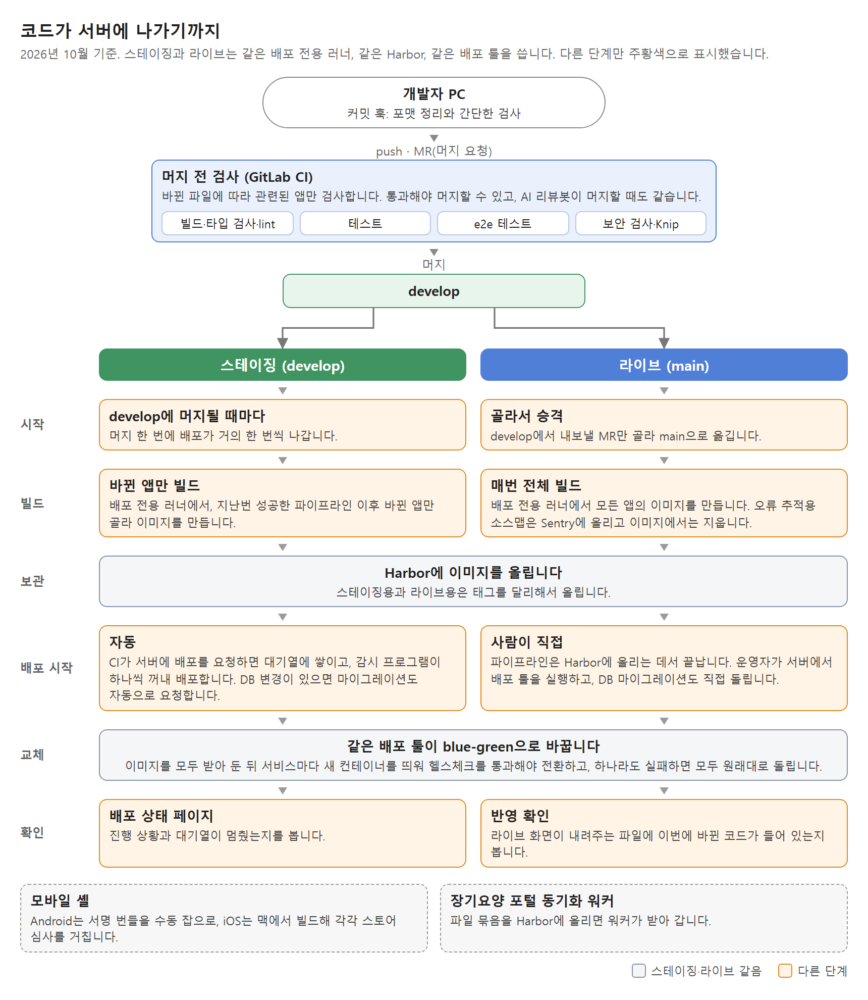
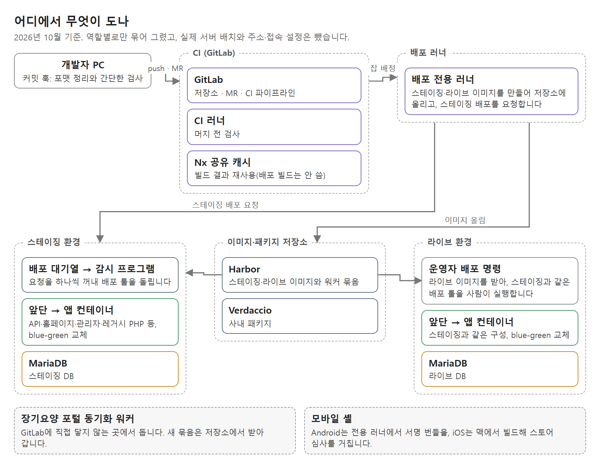

[1편](/monorepo-story-1/)에서는 모노레포가 무엇이고 왜 필요했는지, 그리고 Nx·pnpm·CI로 빌드와 검사를 어떻게 바꿨는지 얘기했습니다. 2편은 테스트와 배포 얘기입니다. 글에 나오는 앱 이름은 1편 앞쪽의 앱 표에 정리해 두었습니다.

2025년까지만 해도 스테이징(테스트 서버) 배포는 사람이 했습니다. 누가 몇 번 리비전을 언제 올렸는지 엑셀 파일에 적어 가며 관리했습니다. 지금은 `develop`(기본 브랜치)에 머지될 때마다 배포가 자동으로 나갑니다. 2026년 9월 말부터 4주 동안 2,635번 나갔습니다. 배포 요청까지는 보통 2분이 안 걸리고, 실제 서버가 새 버전으로 바뀌기까지는 몇 분이 더 걸립니다.

배포가 이만큼 자주 나갈 수 있는 건 머지 전에 테스트가 돌기 때문입니다. 그래서 테스트 얘기를 먼저 하고, 이어서 지금 배포가 도는 방식과 같은 4주 동안 실패한 배포 86번의 원인을 정리했습니다. 배포 쪽은 앱마다 실행되는 곳이 다르고 스테이징과 라이브(실서비스)는 배포하는 방식부터 달라서 탈이 많았습니다.

코드가 서버에 나가기까지의 흐름을 먼저 그림으로 보면 이렇습니다.

---

## 1. 테스트

2026년 7월 초까지만 해도 저장소에는 테스트 파일이 거의 없었습니다. 지금은 2,478개입니다. CI에서 실제로 도는 테스트 수로 세면 3만 3천 개가 넘습니다.

| 시점 | 테스트 파일 | 테스트 코드 |
| --- | ---: | ---: |
| 2026년 7월 초 | 수십 개 | 수천 줄 |
| 2026년 8월 초 | 83개 | 1.1만 줄 |
| 2026년 9월 초 | 447개 | 7.5만 줄 |
| 2026년 10월 초 | 1,274개 | 25만 줄 |
| 2026년 10월 말 | 2,478개 | 53만 줄 |

테스트를 MR(머지 요청)에서 돌리기 시작한 2026년 8월부터 빠르게 늘었습니다. 10월에는 한 달도 안 돼서 테스트 파일이 1,200개, 테스트 코드가 28만 줄 늘었습니다. 하루 평균으로 치면 파일 50개, 코드 1만 줄이 넘습니다.

앱별로는 이렇습니다. 2026년 10월 말에 각 테스트 잡(CI에서 도는 작업 하나)이 마지막으로 실행된 결과에서 셌습니다.

| 대상 | 도구 | 테스트 수 |
| --- | --- | ---: |
| API | Vitest | 14,974개 |
| 주야간 직원앱 | Jest | 8,654개 |
| 탭브레인 서버 | Vitest | 5,391개 |
| 관리자 | Vitest | 1,277개 |
| 공용 함수 패키지 | Jest | 1,107개 |
| 탭브레인 센터 관리 | Vitest | 671개 |
| 홈페이지 | Jest | 617개 |
| 장기요양 포털 동기화 워커 | Jest | 202개 |
| 그 밖(방문요양 API·게이트체크 API·보호자앱·배포 스크립트·CI 설정 등) | Jest, Node 등 | 200개 넘게 |
| e2e(주야간 직원앱 52, 관리자 32, 보호자앱 화면 점검 17) | Playwright | 101개 |

MR을 올리면 바뀐 파일에 따라 관련된 앱의 테스트가 돌고, 통과하지 못하면 머지할 수 없습니다. API 테스트 1만 5천 개를 다 돌려도 5분 정도이고, 주야간 직원앱 테스트 8,654개는 1분 반 정도면 끝납니다.

### 테스트를 CI에 붙이기까지

테스트 파일이 있어도 CI에서 돌지 않으면 모르는 사이에 깨집니다. 주야간 직원앱이 그랬습니다. 한 화면의 데이터 조회 방식을 TanStack Query로 바꿨는데, 그 화면의 테스트는 바뀐 방식에 맞춰 고치지 않아 계속 실패하고 있었습니다. 테스트가 MR에서 돌지 않으니 아무도 몰랐고, 그대로 `develop`에 남아 있었습니다. 2026년 8월에 직원앱 테스트를 MR에서 돌리기 시작하면서 이런 테스트가 드러났습니다.

e2e 테스트(실제 DB와 서버를 띄워 놓고 앱을 돌려 보는 테스트)도 마찬가지였습니다. 직원앱 e2e 테스트는 README에 "CI 잡은 별도 작업 예정"이라고 적힌 채 2026년 9월 전까지 한 번도 머지 전 검사로 돌아간 적이 없었고, 그사이 로그인 횟수 제한이나 쿠키 이름이 바뀌면서 실제 코드와 어긋나 있었습니다. 지금은 관리자와 주야간 직원앱 e2e가 MR에서 머지를 막습니다.

### e2e 테스트

주야간 직원앱 e2e는 MR마다 MariaDB와 레거시 PHP, API, 직원앱을 새로 띄운 다음, 로그인부터 연차·선납금 상계까지 실제로 돌려 봅니다. 52개가 다 도는 데 1분 정도 걸립니다. MR에서는 이 테스트와 관련된 파일이 바뀔 때만 돌고, `develop`에 머지되면 바뀐 파일과 상관없이 전부 다시 돌려서 MR에서 걸러지지 않은 문제를 머지 직후에 찾습니다. 1편에서 든 DB 컬럼 사례도 이 테스트에서 걸렸습니다.

화면 깨짐은 따로 봅니다. 휴대폰 글자 크기를 키우면 직원앱 화면이 깨지는 일이 많아서, 앱 메뉴 16개를 기기와 글자 배율 조합으로 하나씩 열어 보고 깨진 화면을 스크린샷으로 남기는 테스트를 매일 밤 돌립니다. 이 테스트는 머지를 막지 않고, 결과를 보고 사람이 고칩니다.

### 버그 수정과 테스트

같은 4주 동안 버그를 고친 MR을 보면, 70% 넘게 테스트도 같이 고치거나 새로 넣었습니다. 테스트에 이슈리포트(고객 문의로 들어온 오류 신고) 번호를 적어 두는 경우도 많아서, 고친 버그가 다시 들어오면 그 번호가 붙은 테스트가 먼저 깨집니다.

레거시 저장 프로시저를 NestJS 코드로 옮길 때는, 옛 프로시저와 새 코드를 같은 입력으로 돌려 결과가 같은지 대조하는 테스트도 씁니다. 이 테스트는 CI가 아니라 로컬에서만 돌리고, 돌린 뒤에는 쓴 데이터를 모두 되돌립니다.

### 테스트로 막는 것

테스트를 3만 개 넘게 갖고 있어도 빈 곳은 남습니다. 아직 테스트가 적은 앱도 있고, CSS나 PDF 출력처럼 테스트로 잡기 어려운 부분은 지금도 사람이 눈으로 확인합니다. 다만 한 번 고친 버그가 다시 들어오거나, 지금 되는 기능이 모르는 사이에 깨지는 일은 대부분 머지 전에 걸립니다.

---

## 2. Docker와 Harbor

Docker는 처음에 환경을 맞추려고 들였습니다. Node 버전을 Volta·fnm으로 고정한 얘기는 1편에서 했는데요. 사실 그 밖에도 문제가 많았습니다. 예컨대 메인 DB인 MariaDB를 각자 로컬에서는 마음대로 설치해서 서로 다른 버전을 쓰고, 스테이징 서버와 라이브 서버는 또 서로 다른 버전이었습니다. 그러면 오류가 났을 때 어떤 환경의 어떤 버전인지부터 다시 확인해야 합니다.

Docker가 배포의 중심이 된 건 2026년 4월입니다. 사설 이미지 저장소 Harbor를 세우고, Apache/PHP 실행 환경까지 Docker 이미지(앱과 실행 환경을 묶은 배포 파일)로 만들기 시작했습니다. Jenkins와 이후 GitLab CI는 Nx affected로 빌드 대상을 고르고, 이미지를 만들어 Harbor에 올린 뒤 배포를 요청합니다.

### 컨테이너로 바꾼 이유

예전에는 서버에 소스를 받아 놓고, 서버에 설치된 Node·PHP·라이브러리로 실행했습니다. 이러면 서버마다 남아 있는 파일과 패키지가 달라서, 같은 커밋도 서버에 따라 다르게 동작할 수 있습니다.

Docker 이미지로 배포하도록 바꾸면서 역할을 이렇게 나눴습니다.

- CI가 소스와 패키지를 빌드해서 이미지로 만듭니다.
- Harbor가 스테이징·라이브 이미지를 보관합니다.
- 서버는 소스를 다시 빌드하지 않고, 정해진 이미지를 받아서 실행만 합니다.
- DB 비밀번호 같은 설정값은 이미지에 넣지 않고 실행할 때 넣습니다.
- 새 컨테이너(이미지를 띄운 실행 단위)가 정상인지 확인(헬스체크)한 뒤에 트래픽을 넘기고, 문제가 있으면 기존 컨테이너를 그대로 둡니다(blue-green 배포).

어떤 Node와 OS 패키지로 실행하는지가 Dockerfile에 적히니까, 실행 환경을 바꾸는 일도 코드 리뷰를 거치게 됐습니다.

2026년 5월에는 이 배포 로직을 JavaScript 툴로 새로 짰습니다. 여러 서비스를 한 번에 바꿀 때 하나라도 실패하면 모두 원래대로 두는 방식(all or nothing)입니다. 6월에는 PHP 소스까지 이미지에 넣어서, 배포 서버가 SVN에서 소스를 받아 오던 방식을 없앴습니다.

### 이미지 크기와 권한

처음 만든 DB 마이그레이션(DB 구조 변경)용 이미지는 6.43GB였습니다. 필요한 파일만 남겨서 82MB로 줄였고, 이미지를 받는 시간과 되돌리는 시간도 그만큼 줄었습니다.

이 밖에 컨테이너를 root가 아닌 계정으로 실행하기, 베이스 이미지를 태그 대신 내용 해시(digest)로 고정하기, 로그 파일 크기에 상한 두기 같은 규칙이 있습니다. 하나씩 보면 작은 설정인데, 빠뜨렸을 때는 서버 디스크가 꽉 차거나 다음 빌드가 권한 문제로 죽었습니다.

### Jenkins에서 GitLab CI로

Jenkins를 들이기 전에는 개발자 PC나 서버에서 직접 빌드해 파일을 올렸습니다. 이미지를 만들어 올리는 일은 2026년 4월 Jenkins에서 시작했습니다. Jenkins 시절에는 이런 문제가 있었습니다.

- 빌드 한 번에 매번 40분 넘게 걸렸습니다.
- 여러 앱을 동시에 빌드하면 메모리가 모자라서, 동시에 두 개까지만 돌렸습니다.
- Docker 이미지와 빌드 캐시가 Jenkins 서버에 357.7GB까지 쌓여서 디스크를 따로 정리해야 했습니다.
- 바뀐 파일 목록을 빌드 툴에 제대로 넘기지 못해서, 빌드해야 할 앱이 빠지기도 했습니다.

2026년 6월에 저장소를 SVN에서 GitLab으로 옮기면서 CI도 GitLab CI로 바꿨습니다. `develop` 브랜치는 스테이징 서버로, `main` 브랜치는 라이브 서버로 나가게 연결했고, 그달과 다음 달에 걸쳐 Jenkins 파이프라인(커밋마다 도는 잡 묶음)을 모두 걷어냈습니다.

2026년 9월에는 배포 잡만 도는 전용 러너(CI 작업을 실제로 돌리는 서버)를 세웠습니다. 그전에는 배포 잡이 다른 빌드·검사 잡과 러너를 나눠 쓰느라 15분 넘게 차례를 기다린 적도 있었는데, 지금은 2초 안팎이면 시작합니다.

지금 이 일들이 어느 환경에서 도는지는 이렇습니다.

---

## 3. 스테이징 자동 배포

`develop`에 머지될 때마다 스테이징 배포가 한 번씩 돌아갑니다. 2026년 9월 말부터 10월까지 4주 동안의 CI 기록입니다.

| 항목 | 값 |
| --- | ---: |
| 스테이징 배포(성공) | 4주 2,635번 |
| 평일 하루 배포 횟수 | 보통 100번 안팎 (적은 날 13번, 많은 날 227번) |
| 배포 한 번에 걸린 시간(중간값) | 1.7분 |
| 느린 쪽 10% | 7.6분 이상 |
| 실패 | 86번 (약 3%) |

같은 기간 `develop`에 머지된 MR이 3,105건이니, 머지 한 번에 배포가 거의 한 번씩 나갔습니다. 여기서 배포 한 번은 배포 잡이 서버에 배포 요청까지 넣은 것을 셉니다.

### 배포 한 번에 드는 시간

이 가운데 300번을 무작위로 골라, 잡 로그에 찍힌 시각으로 단계를 나눠 봤습니다.

| 단계 | 하는 일 | 걸린 시간(중간값) |
| --- | --- | ---: |
| 소스 받기 | 배포 러너가 `develop`의 최신 코드를 받습니다 | 3초 |
| 설치·준비 | 패키지를 설치하고(1편의 pnpm) Harbor에 로그인합니다 | 5초 |
| 앱 빌드 | 마지막으로 성공한 배포 이후 바뀐 앱만 골라 빌드하고, 나머지는 캐시에서 가져옵니다(1편의 Nx) | 49초 |
| 이미지 만들기·올리기 | 바뀐 앱의 Docker 이미지를 만들어 Harbor에 올립니다 | 44초 |
| 배포 요청 | 스테이징 서버에 "이 이미지들로 바꿔 달라"는 요청을 넣습니다 | 1초 미만 |

시간은 대부분 앱 빌드와 이미지 만들기에 들어갑니다. 공용 코드나 API처럼 여러 앱이 쓰는 코드를 고치면 다시 빌드할 앱이 많아져서, 느린 10%는 앱 빌드에만 평균 6분 넘게 씁니다. 빠른 절반은 평균 1분 남짓이면 다 끝납니다.

이 시간은 서버에 배포를 요청하기까지입니다. 요청을 받은 서버는 배포 대기열에서 차례로 꺼내 새 컨테이너를 띄우고, 헬스체크를 통과하면 옛 컨테이너를 내립니다. 요청부터 실제 교체까지는 보통 몇 분이 더 걸립니다.

### 다시 만드는 이미지

이미지도 바뀐 것만 다시 만듭니다. 이미지 후보는 15개(웹 앱 묶음, 홈페이지, 관리자, API, 레거시 PHP, DB 마이그레이션 등)입니다. 한 번 배포할 때 다시 만드는 이미지는 중간값이 2개이고, 열 번 중 네 번은 1개뿐이었습니다. 매번 같이 만드는 배포 도구 이미지는 빼고 센 숫자입니다. 가장 자주 다시 만드는 건 주야간 직원앱·보호자앱 같은 웹 앱을 한데 묶은 정적 파일 이미지(배포의 91%)이고, 홈페이지·관리자·API는 절반쯤, 레거시 PHP는 8%였습니다.

Dockerfile처럼 Nx가 앱 코드로 보지 않는 파일만 바뀌면 빌드 대상에서 빠지는 일이 있었습니다. 그래서 Dockerfile이나 공용 빌드 스크립트, 패키지 목록 파일이 바뀌면 관련 이미지를 따로 추가하게 했습니다.

빌드는 성공했는데 컨테이너에서 실행이 안 되는 일도 있었습니다. 홈페이지(Next.js)는 이미지에 복사할 파일 목록에서 하나만 빠져도, 컨테이너를 띄우는 순간 모듈을 못 찾고 죽습니다. 이걸 몇 번 겪었습니다.

### 앱별 배포 방식

| 무엇을 | 어떻게 배포하나 |
| --- | --- |
| API·홈페이지·관리자·방문요양 API·게이트체크 API·탭브레인 서버·센터 게임 서버 | 앱별 Docker 이미지 → Harbor → 서버에서 blue-green 교체 |
| 주야간 직원앱·보호자앱·방문요양 직원앱·탭브레인 센터 관리(웹) | 빌드 결과를 정적 파일 이미지 하나로 묶어 같은 경로로 배포 |
| 레거시 PHP | PHP 소스와 Apache 설정을 구운 이미지로 배포 |
| DB 스키마·프로시저 | 마이그레이션 전용 이미지가 배포 때 순서대로 적용 |
| 장기요양 포털 동기화 워커 | GitLab에 직접 닿지 않는 곳에서 돌아서, Docker 이미지 대신 파일 묶음(OCI 아티팩트)을 Harbor에 올리고 워커가 받아 감 |
| Android·iOS 셸 | Android는 서명 번들을 수동 잡으로 만들고, iOS는 맥에서 빌드해 각각 스토어 심사를 거쳐 배포 |

같은 MR에서 고친 코드라도 서버 앱은 몇 분 뒤에 스테이징에 올라가고, 모바일 셸은 스토어 심사를 기다리고, 워커는 새 묶음을 받아 갈 때 바뀝니다.

DB 변경은 네 단계를 차례로 밟습니다.

1. Prisma 마이그레이션으로 테이블 구조를 바꿉니다.
2. 로그 DB처럼 떨어져 있는 다른 DB의 구조를 바꿉니다.
3. 함수와 저장 프로시저를 갱신합니다.
4. SQL만으로 하기 어려운 일회성 데이터 보정 스크립트를 돌립니다.

빌드에는 실제 DB 접속 정보가 필요 없게 해 두었습니다. Prisma 타입은 스키마 파일만 있으면 만들 수 있어서, 빌드 서버나 이미지에는 실제 DB 비밀번호를 넣지 않습니다. 접속 정보는 마이그레이션을 실제로 실행할 때만 서버가 넣어 줍니다.

---

## 4. 배포 실패 86번

4주 동안 배포는 86번(약 3%) 실패했습니다. 실패한 잡 로그를 전부 받아서 원인별로 묶으면 이렇습니다. 같은 원인으로 연달아 실패한 경우가 많았습니다.

| 원인 | 실패 |
| --- | ---: |
| API 코드를 고쳤더니 보호자앱 웹 빌드가 깨짐 | 40번 |
| 보호자앱 웹 빌드 메모리 부족 | 13번 |
| 패키지 잠금 파일(lockfile) 손상 | 7번 |
| 배포 러너가 GitLab에 연결하지 못함 | 7번 |
| PHP 패키지를 받아 오는 외부 저장소 장애 | 6번 |
| 옛 파이프라인 재시도에 밀려난 배포 | 5번 |
| Harbor 오류(서버 오류·주소 조회 실패) | 5번 |
| 잡 멈춤·프로세스 비정상 종료 | 3번 |

47번(보호자앱 빌드 40번, 잠금 파일 7번)은 이미 머지된 코드나 설정이 배포 빌드에서 깨진 경우였고, 18번은 네트워크·Harbor·외부 저장소처럼 코드 밖에서 생긴 문제였습니다. 21번은 배포 환경과 절차의 문제로, 빌드 메모리 부족(13번), 옛 파이프라인 재시도에 밀려난 배포(5번), 잡 멈춤(3번)이었습니다.

### API를 고쳤는데 보호자앱이 깨진 일

2026년 10월 초에 AI 리뷰봇이 API 코드의 lint(코드 규칙 검사) 지적을 정리한 MR 하나를 자동으로 머지했습니다. 머지 전 검사는 모두 통과했는데, 그 뒤로 스테이징 배포가 2시간 반 동안 25번 연속 실패했습니다.

보호자앱 웹 빌드가 깨졌습니다. 그 MR이 코드를 `Map.groupBy`라는 비교적 새 함수로 바꿨습니다. 이 함수는 API의 TypeScript 설정에서는 쓸 수 있지만 보호자앱 설정에서는 못 씁니다. 보호자앱 웹 빌드는 API 응답 타입을 쓰려고 API 소스 코드까지 읽어서 자기 설정으로 다시 검사합니다. 그래서 API 검사는 통과하고 보호자앱 빌드만 실패했습니다. 그리고 API를 고친 MR의 머지 전 검사에는 보호자앱 빌드가 들어 있지 않았습니다. 머지 전 검사에 이런 빈 곳이 있었습니다.

그날 밤 보호자앱 설정을 API와 맞췄는데, 다음 날 오후에 비슷한 이유로 또 깨졌습니다. 이번에는 공용 모듈로 옮긴 코드의 경로 별칭이 보호자앱 설정에 없어서, 1시간 반 동안 15번 실패했습니다. 두 번째 사고 뒤에 이렇게 고쳤습니다.

- 보호자앱이 경로 설정을 따로 들고 있지 않고 공용 설정을 물려받게 했습니다.
- 1편의 캐시 사고 같은 일이 없도록, 보호자앱이 물려받는 설정 파일도 Nx 캐시의 입력에 넣었습니다.
- API나 공용 패키지를 고친 MR에서도 보호자앱 웹 빌드가 머지 전에 돌게 검사 범위를 넓혔습니다.

### 실패 뒤 복구

25번, 15번씩 연달아 실패하는 동안에도 스테이징 서버는 마지막으로 성공한 배포 상태 그대로였습니다. 배포 잡은 바뀐 이미지를 전부 만들어 올린 다음에 배포를 요청하기 때문에, 중간에 하나라도 실패하면 요청이 나가지 않습니다.

배포 잡은 마지막으로 성공한 배포와 비교해서 바뀐 앱을 고릅니다. 그래서 실패한 40번을 하나씩 다시 돌릴 필요는 없었습니다. 고친 MR이 머지되자 다음 배포 한 번이 그동안 밀린 변경을 모두 싣고 나갔습니다.

실패한 옛 파이프라인을 다시 돌리면 오히려 문제가 생깁니다. 옛 커밋으로 만든 이미지가 최신 이미지를 덮어쓰고 배포까지 되기 때문입니다. 2026년 10월에 실제로 멈춘 옛 파이프라인을 다시 돌렸다가 옛 코드가 스테이징에 나갔고, 그사이 대기하던 새 배포 5번은 실행도 못 하고 실패 처리됐습니다(GitLab의 "오래된 배포 막기" 설정 때문입니다). 다음 머지 때 밀린 변경이 함께 나가면서 복구됐습니다. 그 뒤로는 실패하면 고친 코드를 머지해서 풀고, 외부 장애처럼 코드와 상관없는 실패일 때만 가장 최근 파이프라인을 다시 돌립니다.

### 그 밖의 실패

2주 뒤에는 보호자앱 웹 빌드가 메모리 부족으로 죽는 일이 하루 동안 13번 띄엄띄엄 일어났고(같은 기간 성공은 138번), 빌드가 쓸 수 있는 메모리 상한을 8GB로 올려서 해결했습니다.

나머지는 대부분 코드와 상관없었습니다. 배포 러너에서 GitLab으로 연결이 안 돼 소스를 못 받은 게 7번, Harbor가 서버 오류를 내거나 주소를 못 찾은 게 5번이었습니다. 레거시 PHP 이미지는 PHP 패키지를 외부 저장소(PPA)에서 받는데, 그 저장소가 503을 내는 동안 2시간 가까이 배포가 모두 막히기도 했습니다. 이런 실패는 대개 시간이 지나거나 다시 돌리면 해결됩니다.

---

## 5. 라이브 배포

### 승격

`develop`에는 하루 평균 100건 넘게 머지되지만, 전부 바로 라이브에 나갈 준비가 된 건 아닙니다. 그래서 `main`에는 내보낼 MR만 골라서 하나씩 옮깁니다. 이걸 승격(promotion)이라고 부릅니다. GitLab으로 옮긴 2026년 6월 이후 `main`에 머지된 MR 424건 가운데 287건이 승격 MR이고, 따로 114건은 GitLab 화면의 cherry-pick(커밋을 골라 옮기는) 버튼으로 만든 것입니다. 승격과 cherry-pick 모두 변경을 새 커밋으로 옮기기 때문에, `main`에만 있는 커밋도 4,900건이 넘습니다.

골라서 올리다 보니 생긴 문제도 있었습니다.

- 2026년 7월에 MR 몇 개만 골라 올렸더니 그중 하나가 아직 올라가지 않은 다른 MR의 화면과 함수를 부르고 있어서 라이브 빌드가 깨졌습니다. 그 뒤로는 승격 전에 이번에 새로 불러 쓰는 코드(import)가 `main`에 모두 있는지 자동으로 대조합니다. 이 대조로 2026년 8월에 빌드가 깨질 뻔한 한 건을 미리 잡았습니다.
- 반대로 2026년 10월에는 `develop`에서 부르는 곳이 없다며 지운 함수가 `main`에서는 아직 쓰이고 있었습니다. `develop`에서는 그 호출을 없앤 다른 MR이 먼저 머지돼 있었는데, 그 MR이 아직 승격 전이었습니다. 빌드로는 잡히지 않는 경우라 그대로 올렸다면 라이브 화면이 깨졌을 겁니다. 지금은 승격 결과에서 지운 이름을 다시 찾아봅니다.
- 하나씩 승격하다 보면 `main`은 파일마다 `develop`보다 앞서거나 뒤처진 상태가 섞입니다. 날짜를 정해 한꺼번에 승격했을 때 충돌이 124건 났는데, 97건은 내용이 이미 같은 파일, 11건은 줄바꿈만 다른 파일이었고, 실제로 판단이 필요한 건 16건이었습니다. 이 분류를 자동화한 뒤에야 일괄 승격을 할 수 있었습니다.
- 라이브 이미지는 `main` 쪽 파이프라인이 만들기 때문에, `develop`에서 고친 CI 설정은 `main`으로 승격하기 전까지 라이브 빌드에 영향이 없습니다. 이미지 태그 규칙을 `develop`에서만 고쳐 놓고, 라이브는 옛 규칙으로 계속 태그를 찍은 일이 있었습니다.

### 반영 확인

`develop`에 머지되면 이미지 빌드부터 스테이징 배포까지 자동으로 이어집니다. `main` 쪽은 라이브 이미지를 빌드해 Harbor에 올리는 데서 끝나고, 실제 교체는 운영자가 서버에서 배포 툴을 실행할 때 일어납니다. 라이브만큼은 사람이 직접 배포하도록 일부러 남겨 두었습니다.

그래서 파이프라인이 성공해도 라이브에는 아직 반영 전일 수 있습니다. 이미지가 올라간 시각과 실제로 반영된 시각이 두 시간 가까이 벌어진 적도 있습니다. 처음에는 Harbor에 남는 "이미지를 마지막으로 받아 간 시각"으로 반영 여부를 판단했지만, 분명히 배포한 날에도 이 값이 비어 있곤 했습니다. 지금은 라이브 화면이 실제로 내려 주는 파일을 받아서, 이번에 바뀐 코드가 들어 있는지로 확인합니다.

---

## 6. 그 밖의 사고

### 21시간 멈춘 배포 대기열

배포 요청은 스테이징 서버의 대기열에 쌓이고, 서버의 감시 프로그램이 하나씩 꺼내 배포합니다. CI는 요청이 대기열에 들어가면 성공으로 끝납니다. 2026년 9월에 이 감시 프로그램이 순간적인 오류로 몇 번 연달아 죽자, systemd(서버의 서비스 관리자)의 재시작 횟수 제한에 걸려서 서비스가 아예 멈췄습니다. 그 뒤 21시간 동안 배포 요청 27건이 대기열에 쌓였는데, CI에는 계속 성공으로 표시됐습니다. 지금은 재시작 횟수 제한을 없애고, 배포 상태 페이지에 대기열이 멈췄다는 표시가 뜨게 해 두었습니다.

### 러너를 옮긴 날

배포 전용 러너를 다른 서버로 옮긴 날, 배포가 한 건도 나가지 않았습니다. 새 서버의 러너 계정에 Docker 권한이 없었고, 새 서버는 스테이징 접속 설정에도 빠져 있었습니다. 그런데 그 설정을 고치는 배포 역시 같은 이유로 막혀서, 결국 서버에서 직접 손을 써서 풀었습니다.

### 배포 직후의 연결 오류

blue-green 배포는 새 컨테이너가 헬스체크를 통과한 뒤에만 옛 컨테이너를 내립니다. 그런데 배포 툴은 정상이었는데도 배포 직후 API 요청 일부가 연결 오류로 실패한 적이 있습니다. 앞단 Apache에 옛 컨테이너 주소가 남아 있어서, 이미 사라진 주소로 요청이 갔습니다. 전체가 멈춘 게 아니라 잠깐씩 띄엄띄엄 실패해서, 배포 툴 로그만 봐서는 보이지 않았습니다. 지금은 배포가 끝나면 Apache가 설정을 다시 읽게 해서(graceful) 옛 주소를 버리게 합니다.

### 새 서비스 등록

새 NestJS 앱 하나를 스테이징 자동 배포에 올리려면 일곱 군데를 고쳐야 합니다. 빌드 결과 위치 선언, 이미지 빌드 스크립트, CI의 배포 대상 목록, 배포 서버 쪽 등록, 헬스체크 주소, 앱의 헬스체크 엔드포인트, 수동 전체 배포 목록입니다. 하나라도 빠지면 증상이 제각각입니다. 이미지가 아예 안 만들어지기도 하고, 배포 요청이 거절되기도 합니다. 가장 나쁜 경우에는 배포는 성공으로 끝나는데 컨테이너만 옛 버전으로 남고, 로그에도 아무것도 안 남습니다.

게이트체크 API가 그랬습니다. 일곱 번째인 수동 전체 배포 목록만 빠져 있었는데, 자동 배포는 대상 목록을 따로 넘기기 때문에 문제가 없었고 사람이 전체 배포를 돌릴 때만 조용히 빠졌습니다. 그 뒤로는 배포 대상을 적는 목록 세 곳이 서로 어긋나면 CI가 막게 했습니다.

### 저장소 밖의 설정

설정을 전부 저장소에 두려고 했지만, 배포에는 저장소 밖의 상태도 끼어듭니다. API 설정 일부는 저장소가 아니라 서버 쪽에 있어서, 저장소의 설정 파일을 고쳐도 바뀌지 않는 값이 있습니다.

DB 계정도 비슷했습니다. 저장소에는 DB 계정을 만드는 초기화 스크립트가 있지만, 이 스크립트는 DB를 처음 만들 때 한 번만 실행됩니다. 오래 운영 중인 스테이징·라이브 DB에는 나중에 추가한 계정이 만들어진 적이 없었습니다. 게이트체크 API가 처음 배포될 때 이것 때문에 DB에 접속하지 못해서 한 번 더 멈췄습니다.

---

## 앞으로 하고 싶은 것

앞으로 검토할 기술적 결정들을 적어 봤습니다.

1. lint를 ESLint에서 oxlint로 옮기면서 관리자 앱 lint가 30초에서 6초로 줄었습니다. 통과 기준은 그대로였습니다. 이렇게 하는 일은 똑같으면서 5배 이상 빠르거나 메모리를 훨씬 덜 쓰는 도구를 계속 찾아 바꾸겠습니다. 다음 후보는 Webpack을 대신할 Rspack입니다.
2. 커밋 전 단계도 손보려고 합니다. 지금 커밋 훅은 포맷 정리와 몇 가지 간단한 검사뿐이라, lint 같은 검사를 더 걸 생각입니다. 1편에서 얘기한 대로 커밋 훅은 건너뛸 수 있어서 머지 전 검사를 대신하지는 못하지만, MR을 올리기 전에 더 빨리 알려 줄 수는 있습니다.
3. MR 양식과 규칙도 정하려고 합니다. 지금은 MR 제목에 이슈리포트 번호를 넣는 것 말고는 정해진 양식이 없습니다. 무엇을 왜 바꿨는지, 어떻게 확인했는지를 같은 양식으로 적게 하겠습니다.
4. 모듈 페더레이션(앱 하나를 여러 조각으로 나눠 따로 빌드하고 배포하는 방식)도 들이려고 합니다. 주야간 직원앱은 코드가 70만 줄이 넘어서, 화면 하나를 고쳐도 앱 전체를 다시 빌드합니다.
5. 완전한 무중단 배포를 만들고, 마이크로서비스로 나눌 수 있게 준비하는 것도 목표입니다. 지금의 blue-green 배포에도 앞에서 얘기한 Apache 같은 틈이 있었습니다.
6. 라우터 라이브러리는 TanStack Router로 옮기려고 합니다. 관리자는 이미 옮겼고, 주야간 직원앱은 아직 React Router 5를 씁니다. TanStack Router는 화면 주소와 주소에 붙는 값까지 타입으로 검사해 줘서, 없는 화면으로 보내거나 값을 잘못 넘기는 실수를 빌드에서 잡을 수 있습니다.
7. 저장 프로시저와 PHP를 포함한 레거시를 모던한 시스템으로 옮기는 일을 계속합니다. 아직 저장 프로시저와 PHP API가 꽤 남아 있고, 길게는 PHP를 아예 걷어내는 게 목표입니다.
8. JSON 컬럼에 들어 있는 데이터의 타입 검사와 검증도 강화하려고 합니다. 메인 DB 스키마에는 JSON 컬럼이 많은데, 그 안의 값의 모양을 코드에서 보장하지 못하는 곳이 남아 있습니다. 저장하고 읽을 때 검증을 걸고, 정규화해서 테이블로 나눌 수 있는 건 나누는 것도 검토하고 있습니다.

---

## 맺으며

이 저장소는 오랫동안 작은 팀이 맡아 왔고, 사람도 여러 번 바뀌었습니다. 그래서 누군가 기억하고 있어야만 지켜지는 규칙은 오래가지 못했고, 하나씩 도구와 검사로 옮겼습니다.

돌아보면 두 편에 쓴 장치는 대부분 코드가 지금보다 나빠지지 않게 하는 쪽이었습니다. 래칫은 새 오류를 막고, 테스트는 고친 버그가 다시 들어오는 걸 막습니다. 좋게 만드는 일은 그 위에서 하나씩 해 나가려고 합니다.

긴 글 읽어 주셔서 감사합니다.
