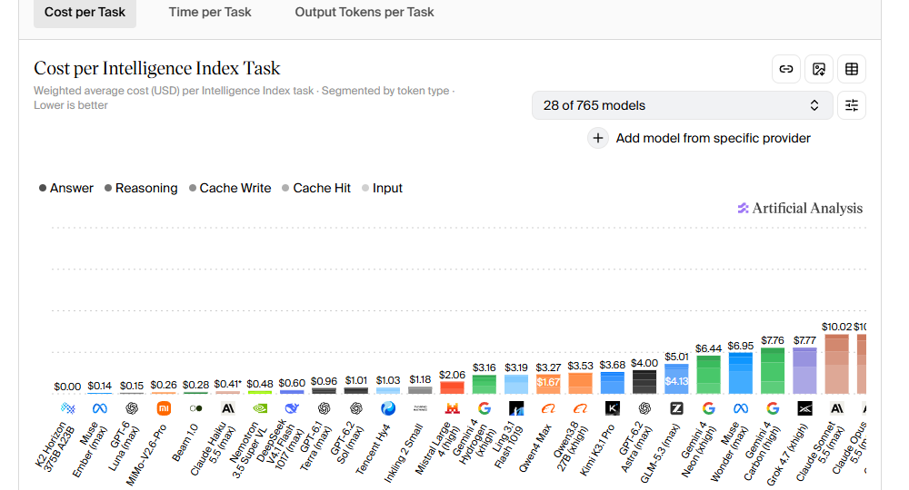

브라우저에서 GPT에게 질문만 넣던 단계에서 한 걸음만 더 가면, 작업 폴더를 지정해 그 안의 파일을 에이전트가 직접 고치게 할 수 있습니다. 퇴근 전에 맡긴 작업이 아침에 머지되어 있기도 합니다.

제목에 연월이 붙어 있습니다. 코딩 에이전트는 쓸 만한 모델과 실행 도구가 한 달, 때로는 일주일 단위로 바뀌기 때문입니다. 2026년 11월 넷째 주에 받은 질문에 답한 내용입니다.

## 웹페이지에서 질문만 해봤다면

Claude Desktop을 열고, 작업 폴더를 지정해 일을 시켜 보세요. 구독 없이 설치해 무료 계정도 채팅 작업을 조금 할 수 있습니다. 사용량은 5시간마다, 그리고 일주일마다 한도가 돌아옵니다. 작업 폴더의 파일을 고치는 기능은 유료 플랜부터입니다.

모델과 effort를 올리면 차이가 더 커집니다. effort는 답을 내기 전에 모델의 추론을 얼마나 오래 시킬지 정하는 설정입니다. 링크 너댓개 주고 분석을 부탁했더니 15쪽짜리 논문에 가까운 글이 나온 경우도 있습니다. 비용이 다섯 배 이상 오르고, 시간도 훨씬 오래 걸립니다. 깊게 파고들 때만 최고 설정으로 올리세요.

## 권한을 물을 때마다 흐름이 끊긴다면

파일을 고치거나 명령을 실행하기 전에 허락을 구하는 모드가 있습니다. 그 확인을 줄이는 기본 모드와, 승인 자체를 끄는 플래그는 다릅니다.

확인을 줄이는 쪽은 이렇습니다.

- Claude Code는 auto 모드가 기본값입니다.
- agy(Antigravity CLI)는 샌드박스가 있는 개인 계정에서 auto 모드가 기본입니다. `agy --mode=auto`로 열거나, 프롬프트에서 Shift+Tab으로 모드를 바꿉니다. 순서는 `default`, `accept-edits`, `auto`, `plan`입니다. auto는 작업 폴더 안의 수정을 승인하고, 명령은 샌드박스에서 실행합니다. 되돌리기 어려운 동작은 여전히 묻습니다. 샌드박스가 없거나 비즈니스·엔터프라이즈 계정이면 `--mode=auto`는 `default`로 실행됩니다.
- Codex는 `/permissions`로 접근 범위를 조절합니다. 작업 폴더 안에서는 고치고 명령을 실행하고, 폴더 밖과 네트워크는 묻는 조합이 `--sandbox workspace-write --ask-for-approval on-request`입니다.

승인 경계를 끄는 플래그를 켜는 방법은 다음과 같습니다.

- `agy --dangerously-skip-permissions`는 도구 요청을 모두 승인합니다. auto 모드를 덮습니다.
- `codex --yolo`는 `--dangerously-bypass-approvals-and-sandbox`의 다른 이름입니다. 승인 질문과 샌드박스를 함께 끕니다.

이 두 플래그는 격리된 실행 환경에서만 씁니다. 브랜치를 나눈다고 저장소 밖에서 실행된 명령이 되돌려지지는 않습니다.

## 방향이 자꾸 빗나간다면

시킨 일과 나온 결과가 달라서 매번 다시 잡아 줘야 한다면, 코드를 시키기 전에 계획을 문서로 남기세요.

agy에서는 plan 모드가 `/plan` 접두어를 붙입니다. Shift+Tab으로 `plan`까지 가거나, 이렇게 시작합니다.

> `/plan` 이 작업의 계획을 먼저 세우자.

Claude Code에도 `/plan`이 있습니다. Claude Desktop에는 이 슬래시 명령이 없고, "코드를 고치기 전에 계획부터 문서로 남겨 줘"라고 보통 문장으로 시키면 됩니다.

계획이 파일로 남아 있으면, 다음 지시는 그 파일을 기준으로 맞출 수 있습니다.

그래도 같은 말을 반복하게 된다면, 그 문서를 만들거나 교체하라고 지시하세요. 에이전트가 보통 스스로 읽는 파일은 `AGENTS.md`입니다. `DECISIONS.md`와 `DESIGN.md`는 `AGENTS.md`나 이후 지시가 그 파일을 가리킬 때 읽습니다.

| 파일 | 담는 것 |
| --- | --- |
| `AGENTS.md` | 이 저장소에서 에이전트가 지킬 작업 방식 |
| `DECISIONS.md` | 이미 정한 선택과 그 이유. 결정사항을 메모리하고, 모든 에이전트에게 공유하기 위해 |
| `DESIGN.md` | 디자인 시스템에 대한 결정사항을 확정하고 공유하기 위해 |

## 몇 시간씩 멈추지 않고 돌리려면

사람을 옆에 두지 않고 에이전트를 몇 시간씩 돌리는 사례가 있습니다. 실행 도구와 플러그인마다 방법이 조금씩 다릅니다. 먼저 프롬프트를 써 보세요.

일을 진행하다가 퇴근 전에 이렇게 남겨 보세요.

> 나 이제 퇴근한다. 아침까지 계획 문서를 참조해서 PR, 수정, 리뷰를 반복하고 머지까지 끝내 줘.

플러그인 이름은 서로 다른 일을 가리킵니다.

- [oh-my-claudecode](https://github.com/Yeachan-Heo/oh-my-claudecode)에서 `/ultrawork`(`ulw`)는 일을 병렬로 실행합니다. 지속이나 검증 루프는 없습니다. 끝날 때까지 검증하며 반복하는 쪽은 `/ralph`이고, autopilot은 그 루프를 포함합니다.
- [oh-my-codex](https://github.com/Yeachan-Heo/oh-my-codex)에서는 병렬 실행이 `$team`입니다.
- 예전에는 [랄프 루프](https://github.com/ghuntley/how-to-ralph-wiggum)를 많이 썼습니다. 지금은 그 방식을 권하지 않습니다. 밤새 맡길 때는 플러그인 이름보다, 위의 퇴근 문장처럼 계획 문서를 기준으로 반복하라고 적는 쪽을 먼저 씁니다.
- [pstack](https://github.com/cursor/plugins/tree/main/pstack)의 `/poteto-mode`는 이런 문장과 함께 씁니다. "자러 간다. 내일 아침까지 계획대로 진행하고, 아침까지 머지하고 싶다." 저장소를 올린 poteto(Lauren Tan)는 한 달 동안 PR을 2,500개 안팎 올렸다고 본인이 밝혔습니다. 본인은 상당수를 코드 정리와 유지보수라고 설명했습니다. 저장소 소개에는 Meta, Netflix, Cursor에서 일했고, React 코어 팀에서 React Compiler를 유지한다고 적혀 있습니다.

남길 것은, 계획을 문서로 남긴 뒤 그 문서를 기준으로 구현과 리뷰와 수정을 아침까지 반복하라고 맡기는 지시입니다.

---

## 쓸 만한 모델은 자주 바뀝니다

아래 평가는 이번 주 기준입니다.

Gemini 3.8 Flash는 한동안 프론티어(그 시점의 최상위)에 가깝게 버티다가, Claude Opus 5에 크게 뒤처졌습니다. 11월 18일에 나온 Gemini 4 Neon이 그 뒤를 다시 넘었습니다. Intelligence Index는 Neon(xhigh) 62, Opus 5.5(max) 59이고, Terminal-Bench 4.1은 65.2% 대 59.1%입니다. 코딩 에이전트로 돌리면 지수도 59 대 58로 Neon이 앞이고, 작업당 비용은 $6.86으로 Opus의 $12.61보다 낮습니다.

계속 쓸 모델이 바뀌므로, 프로그램은 두고 모델만 바꾸는 편이 낫습니다. OpenRouter나 Cursor의 모델 라우터는 여러 모델을 한 자리에서 고르게 해 줍니다.

차선으로 Google 구독도 괜찮습니다. agy(Google Antigravity)에서는 Gemini 4, Gemini 3.8 Flash, Claude Opus 5.5 등을 같이 쓸 수 있습니다.

안정적인 성능을 원한다면 Claude가 아직 무난합니다. 최근 몇 달, 성능과 비용을 안정적으로 유지하는 흐름입니다.

## 구독과, 그것을 돌리는 프로그램은 다릅니다

모델을 구독했다고 해서, 그 모델을 어디에서 돌릴지까지 정해지지는 않습니다.

예를 들어 Claude Code CLI를 쓰더라도 `settings.json`을 고치면 GLM, MiniMax, Qwen, Ollama에 붙여 호출할 수 있습니다. 어떤 모델을 부를지와, 그 API를 어떤 화면에서 돌릴지는 따로 고릅니다.

지금은 [T3 Code](https://t3.codes/)를 씁니다. 모델을 바꾸면 진행 중이던 맥락이 넘어가고, 사용량을 보고, 작업을 여러 개 오갑니다. 브라우저와 마크다운, 이미지, PDF를 그 안에서 엽니다. 프로바이더를 여러 개 붙일 수 있고, 워크트리와 브랜치도 여기서 다룹니다. 휴대폰 앱으로 같은 세션에 이어 들어갈 수 있습니다. 앱 자체는 무료이고, 모델 사용료는 붙여 둔 구독이나 API에서 나갑니다.

같이 볼 만한 것의 역할은 이렇습니다.

| 이름 | 하는 일 |
| --- | --- |
| [Orca](https://orca.dev) | 데스크톱에서 터미널 에이전트를 워크트리로 나란히 실행합니다. Stably AI가 만들었습니다. |
| [Paseo](https://paseo.sh) | 로컬 데몬 위에 데스크톱, 모바일, 웹, CLI가 붙습니다. |
| [Herdr](https://herdr.dev) | 터미널 세션을 붙들어 두는 멀티플렉서입니다. |
| [cmux](https://cmux.com) | macOS 터미널입니다. 에이전트가 기다리면 탭이 켜집니다. |
| [Tern](https://tern.sh) | 에이전트가 고른 결정을 모아 PR 투어로 보여 줍니다. |
| [Pi](https://pi.dev) | 확장과 스킬을 많이 붙여 쓰는 터미널 에이전트입니다. T3 Code나 Paseo 안에서도 돌릴 수 있습니다. |

---

## 맺으며

지금 제가 고른 것은 Gemini 4 Neon과 T3 Code입니다. 한 달 안에 모델과 비용, 돌리는 프로그램도 바뀔 거라고 봅니다. 하지만 퇴근 전에 남기는 프롬프트는 같을 것 같습니다.

> 나 이제 퇴근한다. 아침까지 계획 문서를 참조해서 PR, 수정, 리뷰를 반복하고 머지까지 끝내 줘.
